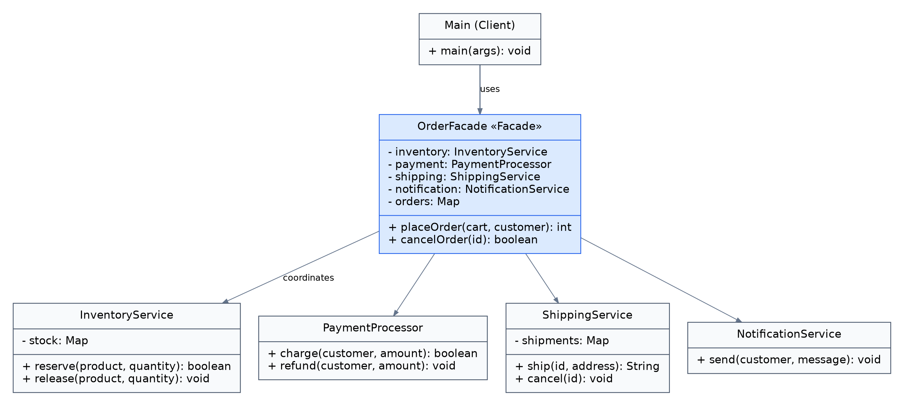

# Assignment #4 - Facade Pattern

## Run
Open this project folder in IntelliJ IDEA, set JDK 17 or newer, mark `src` as Sources Root if needed, and run `Main.java`.
From the project root in the terminal:

```bash
javac --release 17 -d out -sourcepath src src/Main.java
java -cp out Main
```
## How it works

`Main` imports and calls `OrderFacade`.
- `placeOrder(cart,customer)` reserves stock, charges the customer, arranges shipping, saves the order and sends a notification.
- If the product is unavailable, the order fails without charging the customer.
- If payment fails, the reserved stock is released.
- `cancelOrder(id)` cancels shipping then refunds the customer, releases stock and notifies them.
- A placed order returns its ID. A failed order returns `-1`.
The services are in the `subsystem` package and do not depend on `OrderFacade`. `Cart`, `Customer`, and `Order` are supporting data classes.

## UML



## Demo

`Main.java` demonstrates a successful order.


